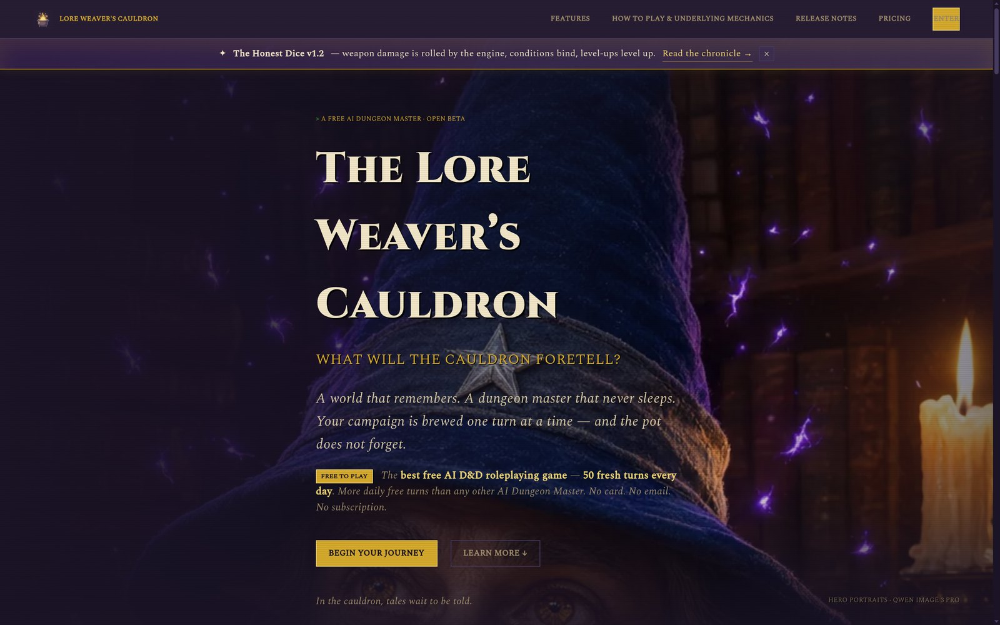
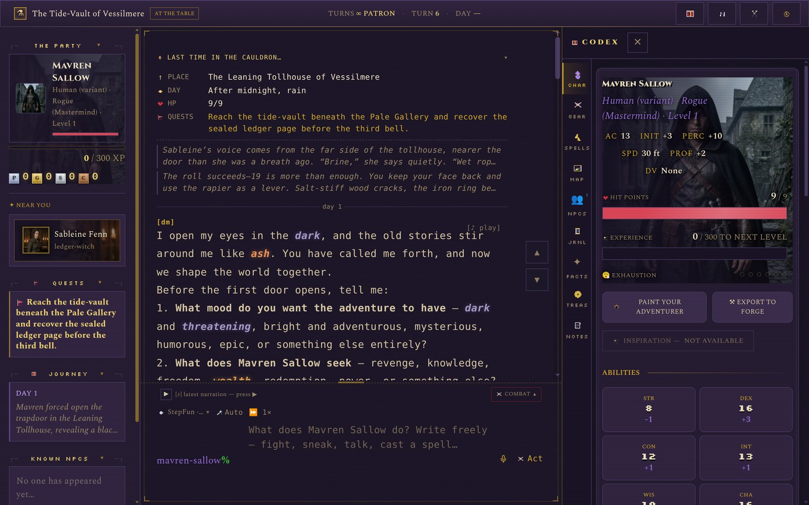

# 🐉 The Lore Weaver's Cauldron — self-host build

> A conversational D&D 5e game where a large language model is your Dungeon Master.
> This repository is the **self-host build**: one Docker image, one Ollama server, your own machine.

**License:** MIT · **Stack:** Python 3.11 / FastAPI · vanilla JS (no build step) · **Mode:** `SELFHOST=1`

## What this is — said plainly

The hosted game at [dnd.rostad.cc](https://dnd.rostad.cc) runs from a **private** codebase: Stripe billing,
daily turn quotas, paid model tiers, cloud Dungeon Masters, voice narration and image generation. That source is
not here.

This repository is the same engine in its **self-host mode**: no billing, no turn limits, and a local
[Ollama](https://ollama.com) model as the only Dungeon Master. The billing and quota code paths still exist in the
files (the engine is one monolith and the split is not done yet) — but in this build they are **inert**: no
billing route is registered, no Stripe key is read, every account resolves to unlimited turns and supporter
features such as undo and campaign export are simply on.

## Quick start

```bash
git clone https://github.com/rostaddotcc/loreweavers-cauldron
cd loreweavers-cauldron

ollama pull qwen3:8b        # or a bigger instruction model — see SELFHOST.md

cp backend/.env.selfhost.example backend/.env.selfhost
# edit backend/.env.selfhost → ADMIN_PASSWORD, JWT_SECRET, SELFHOST_MODEL

docker compose -f docker-compose.selfhost.yml up -d --build
```

Open **http://localhost:8092**, log in with `ADMIN_USER` / `ADMIN_PASSWORD` (created on first start), create a
campaign and send a message. The first turn is slow — Ollama has to load the model into RAM.

Verify:

```bash
curl -s localhost:8092/api/health   # {"status":"ok",…,"selfhost":true}
curl -s localhost:8092/api/config   # {"selfhost":true,"billing":false,…}
```

Full walkthrough — model choice, the Ollama context window (the default 4k is too small), backups, security,
limitations: **[SELFHOST.md](SELFHOST.md)**.

## What the mode changes

| | Hosted | This build |
|---|---|---|
| Billing | Stripe checkout, one-time unlock, donations | **none** — `/api/billing/*` and `/api/stripe/webhook` return 404 |
| Turns | daily cap on free accounts | **unlimited**, no counters, no tiers |
| Undo & export | supporter unlock | **on for every account** |
| Models | Qwen / DeepSeek / StepFun / OpenRouter | **`ollama:<model>`** only, discovered from your server |
| Voice narration | Qwen / StepFun TTS | **absent** (501, hidden in the UI) |
| Image generation | Wan 2.7 / Qwen Image 3 Pro | **absent** (501, hidden in the UI) |
| RAG memory | Qdrant | optional — off unless `QDRANT_URL` is set |

A new public `GET /api/config` reports the build, and `frontend/selfhost.js` hides the billing links, turn
counters and narration controls on every page. Any non-`ollama:` model id — an old campaign's `meta.dm_model`, a
stale cached page — is remapped to the local model instead of failing without an API key.

## The engine, briefly

- **Dungeon Master** — the LLM narrates, plays every NPC and reacts to free-form input; a separate *Guardian*
  module extracts the mechanics (dice, damage, XP, items, gold, quests, conditions) so the story never stops for
  bookkeeping.
- **Server-authoritative dice** — every check, attack and enemy roll happens on the server with `secrets`, and the
  narration is written *after* the outcome exists.
- **Memory** — facts, NPCs, places, quests and a logbook persist per campaign; optional Qdrant RAG with Ollama
  embeddings.
- **Bilingual** — Svenska and English, chosen per campaign. UI chrome stays English.
- **Recovery** — undo the last turn (state included), export a whole campaign as a zip.

## Requirements

Docker + Compose, Ollama reachable from the container, ~4 GB RAM for an 8B model and comfortable headroom.
`SELFHOST.md` covers what to pick and why.

## Screenshots




---

MIT licensed — Copyright (c) 2026 rostad. *Roll well — and mind what the Cauldron foretells.* ⚗️